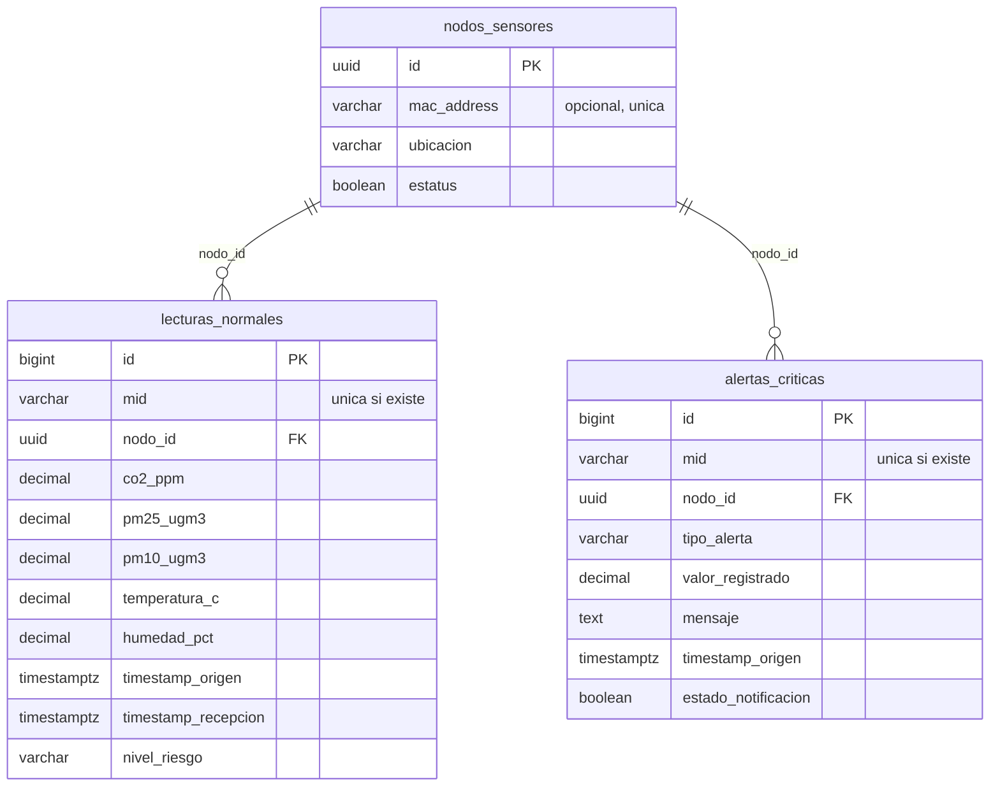

# Sistema de monitoreo de calidad del aire: backend y dashboard

Recibe lecturas de sensores por MQTT (CO2, PM2.5, PM10, temperatura y humedad), clasifica el
riesgo con los niveles de la NOM-172, guarda todo en PostgreSQL, muestra un dashboard en
tiempo real y envía correos de alerta.

## Arquitectura

| Servicio              | Puerto   | Función 
| core-ingesta          | 8081     | Ingesta MQTT, motor de reglas, API REST, WebSocket y dashboard 
| core-notificaciones   | 8082     | Envía los correos de alerta (sin interfaz) 
| Mosquitto             | 1883     | Broker MQTT 
| PostgreSQL            | 5433     | Base de datos (puerto del equipo anfitrión) 

## Requisitos

- Docker Desktop con Docker Compose.
- Internet en el primer arranque (descarga dependencias).
- Opcional: MQTT Explorer para publicar mensajes de prueba.

## Arranque

1. Entra a la carpeta `entorno-iot`.
2. Copia `.env.example` como `.env`. Los valores de base de datos ya funcionan tal cual.
3. Ejecuta `docker compose up -d --build`.
4. Comprueba con `docker compose ps` que los cuatro servicios estén en `Up`.

Abre:
- Dashboard: http://localhost:8081/dashboard.html
- Documentación de la API (Swagger): http://localhost:8081/docs

## Mensajes MQTT que acepta

| Qué             | Tópico                  | Campos 

| Lectura anidada | `fog/lecturas/normales` | `nodo_id`, `timestamp_origen` (ISO 8601 UTC), `lecturas`: `co2_ppm`, `pm25_ugm3`, `pm10_ugm3`, `temperatura_c`, `humedad_pct` 
| Lectura plana   | `planta1/limpio/<id>`   | `mid`, `id`, `ts` (milisegundos desde 1970), `co2`, `pm25`, `pm10`, `temp`, `humedad` 
| Alerta del nodo | `fog/alertas/criticas`  | `nodo_id`, `timestamp_origen`, `tipo_alerta`, `valor_registrado`, `mensaje` 
| Alarma del nodo | `planta1/alarma/<id>`   | `mid`, `estado` (`activa` o `resuelta`), `id`, `variable`, `valor`, `unidad`, `nivel`, `detalle`, `ts` 

Reglas:
- **Variables opcionales:** un mensaje puede traer solo algunas, pero al menos una. Los campos desconocidos se ignoran.
- **Identificador:** un UUID, o un texto como `S_AIRE_06`, del que se deriva un UUID estable. El nodo se registra solo en el primer mensaje, y su nombre queda como ubicación.
- **Tiempo:** `ts` en milisegundos o `timestamp_origen` en ISO. Se rechaza lo anterior a 2020 y lo que esté más de un día en el futuro.
- **Valores:** fuera de rango físico se rechaza el mensaje (por ejemplo, humedad mayor a 100). Cada rechazo queda en el log con su motivo.
- **Duplicados:** se ignoran por `mid`; si no hay `mid`, por nodo y momento. Un mensaje puede ser un objeto o un arreglo de objetos.
- Las alarmas con `estado: "resuelta"` se ignoran.

## Niveles de riesgo (NOM-172)

| Nivel                 | PM2.5 (µg/m³) | PM10 (µg/m³)  | CO2 (ppm)

| Bueno                 | ≤ 12.0        | ≤ 50.0        | ≤ 1000 
| Aceptable             | ≤ 45.0        | ≤ 75.0        | ≤ 1500 
| Malo                  | ≤ 97.0        | ≤ 155.0       | ≤ 2000 
| Muy malo              | ≤ 150.0       | ≤ 235.0       | ≤ 5000 
| Extremadamente malo   | > 150.0       | > 235.0       | > 5000 


## Política de alertas

Hay dos orígenes: el motor de reglas (a partir de nivel Malo) y las alarmas del nodo. Ambas se
guardan y se muestran en el dashboard. Se configura en `core-ingesta/src/main/resources/application.yaml`,
sección `alertas` (después de cambiarla: `docker compose up -d --build`):

| Opción | Por defecto | Efecto |

| `correo-desde-motor` | `true` | Las alertas del motor envían correo |
| `correo-desde-nodo` | `false` | Las alarmas del nodo no envían correo, para no duplicar avisos |
| `enfriamiento-minutos` | 60 | No se repite una alerta del motor para el mismo nodo si ya hubo una igual o más grave en ese lapso; si el nivel empeora, sí avisa. `0` lo desactiva |
| `antiguedad-maxima-minutos` | 30 | Los eventos más viejos se guardan sin avisar, para no mandar correos de eventos pasados cuando el nodo reenvía datos acumulados. `0` lo desactiva |

## Probar con datos

Sin el nodo físico, se publican mensajes a mano, desde MQTT Explorer (`localhost:1883`, QoS 1,
Retain desactivado) o desde PowerShell con este ayudante, que no necesita instalar nada más.
El `ts` y el `mid` deben ser nuevos en cada mensaje; si la fecha es muy vieja o futura, el
mensaje se rechaza.

```powershell
$ts   = [DateTimeOffset]::UtcNow.ToUnixTimeMilliseconds()
$iso  = (Get-Date).ToUniversalTime().ToString("yyyy-MM-dd'T'HH:mm:ss'Z'")
$nodo = "11111111-1111-1111-1111-111111111111"
$archivo = Join-Path $env:TEMP "mqtt-prueba.json"

function Publicar($topico, $json) {
    [System.IO.File]::WriteAllText($archivo, $json, (New-Object System.Text.UTF8Encoding($false)))
    docker cp $archivo broker-mosquitto:/tmp/mqtt-prueba.json | Out-Null
    docker exec broker-mosquitto mosquitto_pub -h localhost -t $topico -q 1 -f /tmp/mqtt-prueba.json
}

# Lectura normal, formato plano
Publicar "planta1/limpio/$nodo" "{`"mid`":`"demo:$ts`",`"id`":`"$nodo`",`"ts`":$ts,`"co2`":650,`"pm25`":14,`"pm10`":30,`"temp`":22.5,`"humedad`":55}"

# PM2.5 en 60: nivel Malo, genera una alerta (y correo, si está configurado)
Publicar "planta1/limpio/$nodo" "{`"mid`":`"demo:$($ts+1000)`",`"id`":`"$nodo`",`"ts`":$($ts+1000),`"pm25`":60}"

# Alerta del nodo, formato anidado
Publicar "fog/alertas/criticas" "{`"nodo_id`":`"$nodo`",`"timestamp_origen`":`"$iso`",`"tipo_alerta`":`"PICO_PM25`",`"valor_registrado`":150.8,`"mensaje`":`"Prueba`"}"
```

El dashboard debe actualizarse al instante. Los mensajes rechazados o ignorados se ven en el log:
`docker compose logs -f core-ingesta`.

## Correo (opcional)

Para recibir correos de alerta, llena en `entorno-iot/.env` `MAIL_USERNAME` (cuenta de Gmail),
`MAIL_PASSWORD` (contraseña de aplicación de 16 caracteres; requiere verificación en dos pasos)
y `MAIL_DESTINATARIO` (varias direcciones separadas por coma). Después: `docker compose up -d`.
Sin esto, todo lo demás funciona y el log avisa que no hay destinatarios configurados.

## API

Detalle y pruebas interactivas en http://localhost:8081/docs.

- `GET /api/v1/lecturas/ultima/{nodoId}`, `GET /api/v1/lecturas/historico` (con `nodoId` y `horas`, o `desde` y `hasta`), `GET /api/v1/lecturas/primera`
- `GET /api/v1/alertas/recientes`
- `GET` y `POST /api/v1/nodos`, `GET` y `PUT /api/v1/nodos/{id}` (para asignar la ubicación de un nodo)
- WebSocket: `/ws-calidad-aire` (STOMP sobre SockJS), tópicos `/topic/lecturas` y `/topic/alertas`

## Base de datos

El esquema está en `entorno-iot/init-db.sql` y se crea solo la primera vez que arranca PostgreSQL.



## Pruebas automáticas

Requieren JDK 17. Desde `core-ingesta`: `./mvnw test` (en Windows, `.\mvnw.cmd test`). Cubren el
normalizador de mensajes, el motor de reglas y las decisiones del suscriptor (duplicados,
alarmas resueltas, enfriamiento y antigüedad). La prueba `contextLoads` está desactivada porque
necesita PostgreSQL y Mosquitto levantados.

## Detener y reiniciar

- `docker compose down`: detiene todo y conserva los datos.
- `docker compose down -v`: detiene todo y borra la base de datos.

## Problemas comunes

- En el primer arranque, `core-ingesta` puede reiniciarse una o dos veces mientras PostgreSQL se inicializa. Es normal.
- Si un puerto está ocupado (8081, 8082, 1883, 5433), cierra el programa que lo usa.
- Si el dashboard no muestra un dato que acabas de publicar, revisa el `ts`: debe ser la hora UTC actual, en milisegundos.
- El correo puede tardar unos segundos en salir.

## Estructura del repositorio

```
core-ingesta/         Ingesta MQTT, normalizador, motor de reglas, API REST, WebSocket y dashboard (src/main/resources/static)
core-notificaciones/  Envío de correos de alerta
entorno-iot/          docker-compose.yml, init-db.sql, mosquitto.conf y .env.example
```

## Estado del proyecto

Funcionando: ingesta de varios formatos de mensaje, motor de reglas NOM-172, dos microservicios
desacoplados, notificaciones por correo con política configurable, dashboard en tiempo real con
histórico, pruebas unitarias y despliegue con Docker.

Pendiente: pruebas de integración con el nodo fog físico, autenticación del broker MQTT,
confirmación de recepción hacia el nodo (`API_ACK`, no implementada), reintento de los correos
pendientes y migraciones versionadas del esquema.